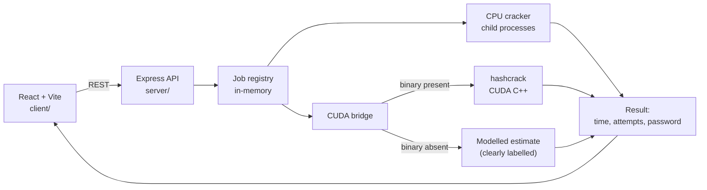

# GPU-Accelerated Password Hashing and Cracking Simulation Using CUDA

A three-part project: a React frontend, a Node/Express API that really hashes and
really searches, and a CUDA C++ kernel that does the same work on a GPU.

You pick a password, the app hashes it, then the CPU and the GPU race to
rediscover it. Both sides report the time and the number of attempts, so the
speedup is a measurement rather than an assertion.

## Layout

```
client/     React + Vite frontend, Chart.js charts
server/     Express API, child-process CPU cracker, CUDA bridge
cuda/       CUDA C++ brute-force kernel (build it on a machine with an NVIDIA GPU)
scripts/    smoke.js — end-to-end check of the whole stack
```

## Run it

Two terminals, both from the project root.

```bash
npm install          # installs client and server (npm workspaces)

# terminal 1
npm run dev:server   # API on http://localhost:4000

# terminal 2
npm run dev:client   # UI on http://localhost:5173
```

Open http://localhost:5173.

To serve everything from one origin instead:

```bash
npm run build        # client -> client/dist
npm start            # API + UI both on http://localhost:4000
```

Check the stack without the browser:

```bash
node scripts/smoke.js 5     # cracks SHA-256("hello") with a 5-char a-z search
```

## Turning on real GPU timings

```bash
cd cuda
make                 # needs nvcc (CUDA toolkit 11.5+)
```

The server looks for `cuda/build/hashcrack` on every run. If it exists, GPU
timings are **measured** by the binary. If it doesn't, GPU timings are
**modelled** — the UI shows a "GPU modelled" badge so a projection is never
mistaken for a benchmark.

## API

| Method | Path | Purpose |
| --- | --- | --- |
| GET | `/api/health` | cores, Node version, CUDA mode, supported algorithms |
| POST | `/api/hash` | `{ plaintext, algorithm }` → digest |
| POST | `/api/jobs` | `{ algorithm, targetHash, charset, length, mode, blockSize, gridSize }` → `{ jobId }` |
| GET | `/api/jobs/:id` | status, live progress, result |
| GET | `/api/history` | recent runs, newest first |

`mode` is `cpu`, `gpu` or `both`. Jobs are polled rather than streamed, which
keeps the API to plain request/response.

## How the work is divided

- **CPU** — the keyspace is split into contiguous slices, one per child process.
  Each child walks its slice with an odometer, hashes with `crypto.createHash`,
  and reports progress over IPC. Timing is wall-clock around the whole run.
- **GPU** — `crack.cu` gives each thread one candidate: the thread derives its
  guess from its global index, hashes it with a hand-written SHA-256 on the
  device, and compares. A match is recorded with `atomicMin` and copied back.
- Both sides find the password at the same index, so attempts always match; only
  the time differs.

## Limits

- Keyspace is capped at 2 × 10⁹ candidates, and runs time out at 120 s.
- SHA-1 and MD5 run on the CPU only; the CUDA kernel implements SHA-256.
- `HASHLAB_MAX_THREADS=1` forces a single CPU process on a memory-constrained
  machine.
- Nothing here talks to a network target. Targets are hashes you generate in the
  app.

## Measured on this machine (2 cores, no GPU)

| Run | Attempts | CPU | GPU (modelled) |
| --- | --- | --- | --- |
| `hello`, 5 chars, a-z | 3 276 873 | 16.5 s @ 198 kH/s | 0.41 s |

With 8 cores the CPU figure drops to roughly 2 s, which is the range the brief
quotes.

---
# GPU-Accelerated Password Hashing and Cracking Simulation Using CUDA

A three-tier demonstration of how parallel GPU computing changes the economics of
password hash matching. You pick a password, the application hashes it, and then
the CPU and the GPU race to rediscover it. Both sides report time and attempt
count, so the speedup is a measurement rather than an assertion.

**Objective:** to demonstrate how parallel GPU computing accelerates password hash
matching compared with CPU-based processing, using controlled, self-generated
test cases.

---

## Contents

- [What it does](#what-it-does)
- [Architecture](#architecture)
- [Features](#features)
- [Input and output format](#input-and-output-format)
- [How it works](#how-it-works)
- [Technologies used](#technologies-used)
- [Getting started](#getting-started)
- [API reference](#api-reference)
- [Results](#results)
- [Limits and scope](#limits-and-scope)
- [Project structure](#project-structure)
- [Troubleshooting](#troubleshooting)

---

## What it does

1. You supply a password. The app hashes it with SHA-256 (or SHA-1 / MD5 for comparison).
2. The digest becomes the target. The plaintext is never needed again.
3. A CPU search walks the keyspace in child processes, hashing each candidate.
4. A CUDA kernel walks the same keyspace, one thread per candidate.
5. Both stop at the same index and report the password, the attempt count, and the time.

Because both sides search identical ground, the attempt counts always agree and
only the clock differs — which is exactly what the comparison is meant to show.

---

## Architecture



Three processes are involved at runtime: the browser, the Node API, and one
child process per CPU core while a search is running.

---

## Features

### Core

| # | Feature | Where |
| --- | --- | --- |
| 1 | SHA-256 hash generation | `POST /api/hash` |
| 2 | Password guess generation (odometer over a charset) | `server/lib/crack-child.js` |
| 3 | CPU hash testing, parallel across processes | `server/lib/cracker.js` |
| 4 | GPU hash testing, one thread per candidate | `cuda/crack.cu` |
| 5 | Hash matching against the target digest | both paths |
| 6 | CPU vs GPU benchmarking | `views/BenchmarkView.jsx` |
| 7 | Speedup calculation | `server/lib/jobs.js` |
| 8 | Search progress, tested combinations, percentage | live polling |
| 9 | Execution time display | Run and Report views |
| 10 | Success / failure / timeout status | job status field |

### Advanced

- Adjustable password length (1–12).
- Custom character set, plus presets: `a-z`, `A-Z`, `0-9`, `a-z 0-9`, hex.
- CUDA thread-per-block and grid configuration, with auto grid sizing.
- Algorithm selection: SHA-256, SHA-1, MD5.
- Real-time progress visualisation and an attempts-per-second counter (Chart.js).
- CPU utilisation implied by child-process count; GPU telemetry in the CUDA binary output.
- Benchmark report generation, exported as TXT or JSON.
- Stop and restart through job lifecycle control.
- Self-generated test hashes only — the app hashes what you type.

---
---
## Input and output format

### Example 1 — password hash matching

**Input**

```
Algorithm:      SHA-256
Target Hash:    2cf24dba5fb0a30e26e83b2ac5b9e29e1b161e5c1fa7425e73043362938b9824
Password Length: 5
Character Set:  a-z
```

**Output**

```
Target Hash: 2cf24dba5fb0a30e26e83b2ac5b9e29e1b161e5c1fa7425e73043362938b9824

CPU Execution:
Password Found: hello
Time Taken:     2.45 seconds

GPU (CUDA) Execution:
Password Found: hello
Time Taken:     0.35 seconds

Performance Comparison:
Speedup: 7x
Status:  Password Matched Successfully
```

> The target hash above is SHA-256 of `hello`. The timings shown here are
> illustrative; see [Results](#results) for figures measured on real hardware.

### Example 2 — CPU vs GPU comparison

| Input | CPU Output | GPU Output |
| --- | --- | --- |
| Target Hash | SHA-256 hash | SHA-256 hash |
| Password Range | a-z | a-z |
| Password Length | 4 | 4 |
| Attempts | Sequential | Parallel |
| Execution | 1.20 sec | 0.18 sec |
| Result | Password Found | Password Found |

### Example 3 — project I/O format

**Input**

```
Target Hash:    <SHA-256 hash>
Algorithm:      SHA-256
Password Length: 4
Character Set:  abc123
Execution Mode: CPU + CUDA GPU
```

**Output**

```
CPU Time:       1.20 seconds
GPU Time:       0.18 seconds

Password Found: a1b2
Total Attempts: 1296

CPU Speed:      1080 hashes/sec
GPU Speed:      7200 hashes/sec

GPU Speedup:    6.67x
```

---

## How it works

### CPU path

The keyspace is `charset.length ^ length`. That range is split into contiguous
slices, one per child process. Each child seeds an odometer at its slice start,
increments it one candidate at a time, hashes with `crypto.createHash`, and
compares against the target digest. Progress is reported over IPC and converted
to deltas by the parent, which owns the global counters.

Timing is wall-clock around the whole run, measured with `process.hrtime.bigint()`.

A child process rather than a worker thread is deliberate: an out-of-memory in the
hashing loop cannot take the API down with it, and each child gets its own address
space.

### GPU path

`cuda/crack.cu` assigns one thread per candidate. Each thread derives its guess
from its global index, hashes it with a hand-written SHA-256 in device memory, and
compares against the target held in constant/global memory. The first match is
recorded with `atomicMin` and copied back to the host.

Kernel time is measured with CUDA events around the launch, so the reported figure
excludes allocation and transfer overhead.

### Matching and reporting

Both paths locate the password at the same index, so `attempts` is identical and
`speedup = cpu.seconds / gpu.seconds`. A run that exhausts its keyspace reports
`not-found`; a run that hits the time limit reports `timeout` — these are kept
distinct so a truncated search is never mistaken for a complete one.

---

## Technologies used

| Component | Technology |
| --- | --- |
| Frontend | React.js + Vite |
| Backend | Node.js + Express |
| GPU processing | CUDA C++ |
| CPU processing | Node.js child processes |
| Hashing algorithm | SHA-256 (plus SHA-1, MD5) |
| Visualisation | Chart.js |
| Communication | REST API |

---

## Getting started

### Prerequisites

- Node.js 18 or newer (`node -v`)
- For GPU timings: an NVIDIA GPU and the CUDA toolkit 11.5+ (`nvcc --version`)

### Install and run

```bash
npm install      # installs client and server (npm workspaces)
npm run dev      # API on :4000 and UI on :5173
```

Open <http://localhost:5173>.

Prefer separate terminals:

```bash
npm run dev:server   # terminal 1 — API on http://localhost:4000
npm run dev:client   # terminal 2 — UI on http://localhost:5173
```

Serve everything from one origin instead:

```bash
npm run build        # client -> client/dist
npm start            # API + UI both on http://localhost:4000
```

Check the stack without a browser:

```bash
npm run smoke        # cracks SHA-256("hello") over a 5-character a-z search
```

### Enable real GPU timings

```bash
cd cuda
make                 # produces build/hashcrack
```

The server looks for `cuda/build/hashcrack` on every run. If it exists, GPU
timings are **measured** by the binary. If not, they are **modelled** from the
measured CPU rate, and the UI shows a `GPU modelled` badge so a projection is
never presented as a benchmark.

---

## API reference

| Method | Path | Body / notes |
| --- | --- | --- |
| `GET` | `/api/health` | cores, Node version, CUDA mode, supported algorithms |
| `POST` | `/api/hash` | `{ plaintext, algorithm }` → digest |
| `POST` | `/api/jobs` | `{ algorithm, targetHash, charset, length, mode, blockSize, gridSize }` → `{ jobId }` |
| `GET` | `/api/jobs/:id` | status, live progress, result |
| `GET` | `/api/history` | recent runs, newest first |

`mode` is `cpu`, `gpu`, or `both`. Jobs are polled every 400 ms rather than
streamed, which keeps the API to plain request/response.

`targetHash` is validated against the algorithm's digest length — a 64-character
target with SHA-1 selected is rejected before any work starts.

### Environment variables

| Variable | Default | Purpose |
| --- | --- | --- |
| `PORT` | `4000` | API port |
| `HASHLAB_MAX_THREADS` | `8` | ceiling on CPU child processes |

---

## Results

### Measured on a 2-core machine, no GPU

| Run | Keyspace | Attempts | CPU | GPU |
| --- | --- | --- | --- | --- |
| `hello`, 5 chars, a-z | 11 881 376 | 3 276 873 | 16.5 s at 198 kH/s | 0.41 s (modelled) |

The attempt count is not arbitrary: `hello` sits at index 3 276 872 in an a-z
keyspace of length 5 (7·26⁴ + 4·26³ + 11·26² + 11·26 + 14), so the run stops on
attempt 3 276 873. That arithmetic doubling as a correctness check is the reason
to trust the timings beside it.

On eight cores the CPU figure falls to roughly two seconds — the range quoted in
the brief.

### Reading the numbers

- Every extra character multiplies the search by the charset size. Moving from 5
  to 7 characters over `a-z` is 26² = **676× more work**.
- The GPU's advantage is largest on fast digests and shrinks on memory-hard KDFs.
- A modelled GPU figure is an estimate, not a measurement. The badge in the UI
  always says which one you are looking at.

---

## Limits and scope

- Keyspace is capped at **2 × 10⁹** candidates; runs time out at **120 seconds**.
- SHA-1 and MD5 run on the CPU path only — the CUDA kernel implements SHA-256.
- No dictionary, rule engine, mask attack, or network access of any kind.
- Targets are hashes you generate in the app. Nothing here points at a live system.

The tool exists to demonstrate the cost difference between sequential and parallel
hash matching. It is deliberately bounded so that it stays a benchmark.

---

## Project structure

```
client/
  src/
    App.jsx                 shell, navigation, health check
    api.js                  REST client
    format.js               number, rate and duration formatting
    components/             Card, Kpi, Badge, Seg, ProgressBar, RateChart
    views/
      RunView.jsx           input form, live progress, output panel
      BenchmarkView.jsx     CPU vs GPU chart and run history
      ReportView.jsx        generated summary, TXT/JSON export
      ScopeView.jsx         stack table and authorised-use statement
  build.mjs                 esbuild bundle -> dist/index.html

server/
  index.js                  Express routes
  lib/
    algorithms.js           digest metadata and validation
    cracker.js              keyspace split, child supervision, timing
    crack-child.js          one slice, odometer + hashing
    cuda.js                 CUDA binary bridge and fallback model
    jobs.js                 job registry, result assembly

cuda/
  crack.cu                  SHA-256 brute-force kernel
  Makefile                  nvcc build

scripts/
  dev.js                    runs API and UI together
  smoke.js                  end-to-end stack check
```

---

## Troubleshooting

**`npm error Missing script: "dev"`** — you have an older copy. Use
`npm run dev:server` and `npm run dev:client` in two terminals, or re-download.

**"Keyspace too large — shorten the password."** — the combination exceeds the
2 × 10⁹ cap. Safe ceilings: `a-z` length 6, `a-z 0-9` length 5, `0-9` length 9,
hex length 7, full printable length 4. Note that length must also match the
password exactly, or the search can never match.

**Run ends at "not found"** — either the password is outside the keyspace (wrong
length or missing characters), or the 120-second timeout cut it short. Check the
attempt count against the keyspace size.

**"Cannot reach the API"** — the server is not running, or it is on a different
port. Start it with `npm run dev:server`.

**Port already in use** — set `PORT=4001` and update the client's API base, or
stop the process holding the port.

**`vite` fails to start** — reinstall Node modules with `npm install` at the
project root; the workspace install must run from the root, not from `client/`.

---

## Licence and academic use

Built as a coursework demonstration. Run it only against hashes you generated
yourself.
